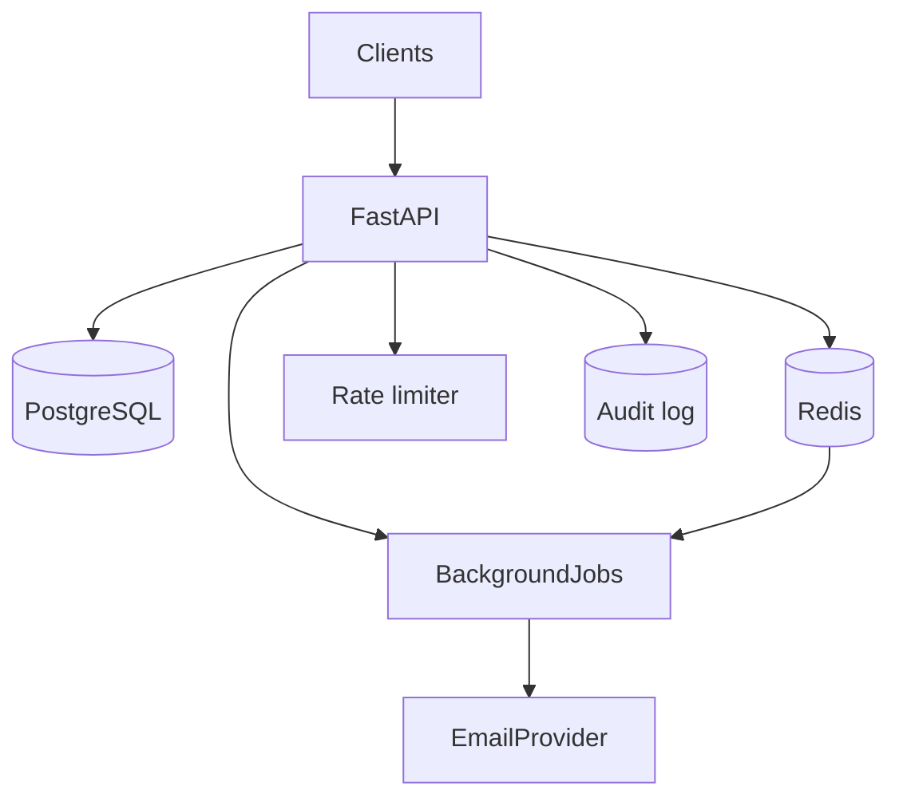
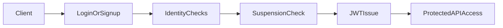
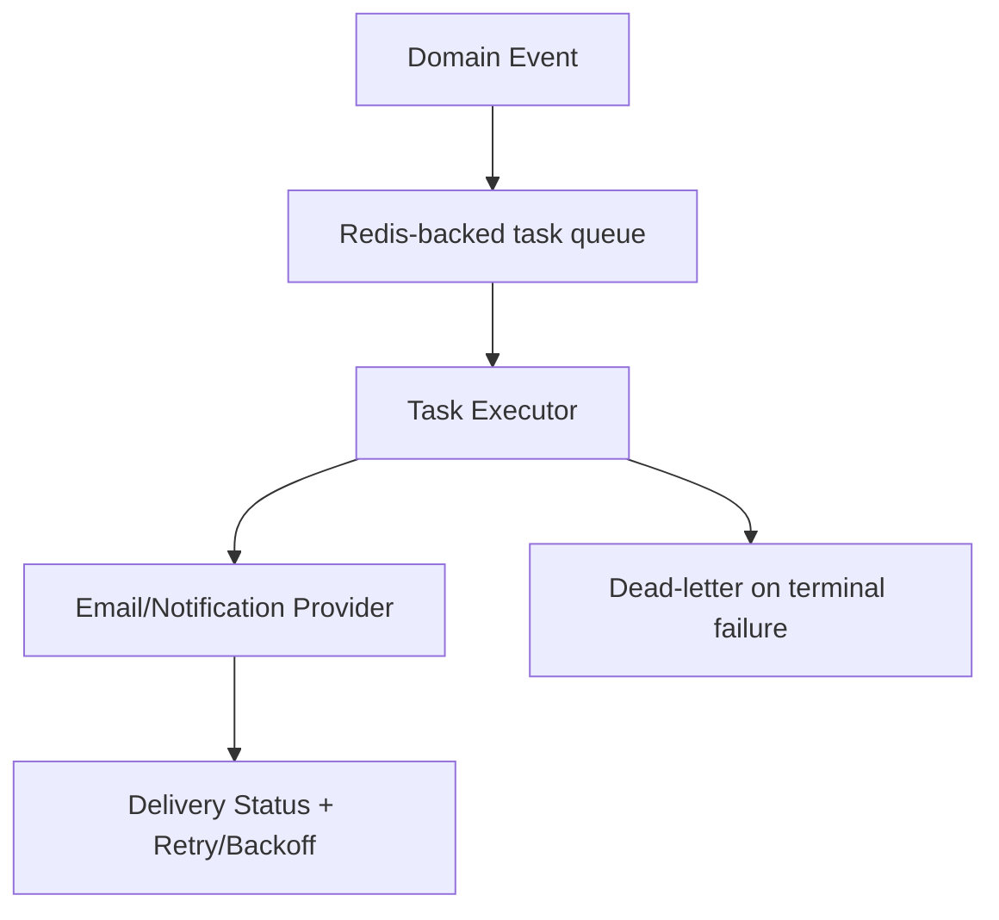

## Launchpad Project Specifications

🚀 Product launch and discovery platform for founders and makers.

---

## Launchpad Project Specifications

🚀 **Community-driven launch platform** with moderation, ranking, voting, discovery, and founder analytics.

---

## 📌 Problem (Core Idea)

Founders need a trusted platform to launch products and get community feedback, while members need high-signal discovery instead of noisy listings.

Without moderation, anti-abuse rules, and quality ranking, product discovery becomes low trust and low value.

➡️ **Launchpad provides structured submissions, moderated publishing, fair ranking, and real-time community interaction.**

---

## 🧑‍💻 Users

| Persona  | Needs |
| -------- | ----- |
| Visitor  | Browse launches and evaluate products |
| Member   | Vote, comment, follow topics and makers |
| Founder  | Submit products, schedule launch, track performance |
| Reviewer | Moderate submissions and reported content |
| Admin    | Govern platform integrity and policy actions |

---

## ✨ Core Features

### A) Profiles & Authentication

- Email/password signup/login
- Google sign-in seam
- Email verification
- Password reset and change
- JWT access/refresh authentication with refresh-token rotation and revocation
- Account suspension (admin) enforced at the auth boundary

### B) Product Submission & Moderation

- Draft submission workflow
- Structured submission metadata and assets
- Reviewer outcomes: approve, reject, request changes
- Founder notifications for moderation decisions
- Admin takedown/restore and front-page featuring

### C) Launch Scheduling & Visibility Rules

- Founder-selectable launch day for approved products
- Daily launch quota constraints per founder
- Embargo before launch day
- Restricted edit policy after launch

### D) Voting, Comments, and Reporting

- Single vote per member/product
- No self-voting
- Threaded comments and replies
- Report pipeline for moderation (assign / resolve / dismiss)

### E) Discovery, Ranking, and Topic Views

- Velocity-aware dynamic ranking for daily launches
- Immutable historical day snapshots
- Topic leaderboard views (week/month/all-time)
- Full-text search with topic filter and newest/most-voted sort
- Staff-featured products pinned on the front page

### F) Notifications & Background Jobs

- In-app and email notifications
- User-level email preference enforcement
- Durable Redis-backed async processing with retry/backoff, dead-lettering, and a worker
- Asynchronous founder dashboard exports

### G) Staff Tools & Governance

- Submission review queue (oldest first) and report queue
- Suspend/reactivate members, takedown/restore products, feature/unfeature products
- Immutable audit log of staff actions
- Abuse-monitoring signals (rate limiting + suspicious-behavior hooks)

---

## 🗄️ Data Model

Core entities:

- User, role, and profile (users carry an `active`/`suspended` status)
- Product, submission, topic, and launch
- Vote, comment, and report
- Notification preferences, notifications, and delivery events (with retry tracking)
- Staff actions and audit logs
- Member and topic follows
- Discovery day snapshots and ranked snapshot items
- Founder exports and featured products

### Entity Relationship Diagram

```mermaid
erDiagram
    USERS ||--o{ PROFILES : "has"
    ROLES ||--o{ PROFILES : "grants"

    PROFILES ||--o{ PRODUCTS : "founds"
    PRODUCTS ||--o| PRODUCT_LAUNCHES : "launches"
    PRODUCTS ||--o{ PRODUCT_TOPICS : "tagged"
    TOPICS ||--o{ PRODUCT_TOPICS : "tags"

    PROFILES ||--o{ SUBMISSIONS : "submits"
    PRODUCTS ||--o{ SUBMISSIONS : "moderated"

    PROFILES ||--o{ VOTES : "casts"
    PRODUCTS ||--o{ VOTES : "receives"

    PROFILES ||--o{ COMMENTS : "writes"
    PRODUCTS ||--o{ COMMENTS : "receives"
    COMMENTS ||--o{ COMMENTS : "replies to"

    PROFILES ||--o{ REPORTS : "files"
    PRODUCTS ||--o{ REPORTS : "targeted product"
    COMMENTS ||--o{ REPORTS : "targeted comment"

    PROFILES ||--o| NOTIFICATION_PREFERENCES : "configures"
    PROFILES ||--o{ NOTIFICATIONS : "receives"
    NOTIFICATIONS ||--o{ NOTIFICATION_DELIVERIES : "delivered via"

    PROFILES ||--o{ STAFF_ACTIONS : "performs"
    PROFILES ||--o{ AUDIT_LOGS : "performs"

    PROFILES ||--o{ MEMBER_FOLLOWS : "follows"
    PROFILES ||--o{ TOPIC_FOLLOWS : "follows"
    TOPICS ||--o{ TOPIC_FOLLOWS : "followed"

    DAY_SNAPSHOTS ||--o{ DAY_SNAPSHOT_ITEMS : "contains"
    PRODUCTS ||--o{ DAY_SNAPSHOT_ITEMS : "ranked in"

    PRODUCTS ||--o| FEATURED_PRODUCTS : "promoted"
    PROFILES ||--o{ FEATURED_PRODUCTS : "featured by"

    PRODUCTS ||--o{ FOUNDER_EXPORTS : "exported"
    PROFILES ||--o{ FOUNDER_EXPORTS : "requests"

    USERS {
        int id PK
        string email UK
        string auth_provider
        string first_name
        string last_name
        bool email_verified
        string status
        datetime suspended_at
        string suspension_reason
    }
    ROLES {
        int id PK
        string name
        string slug UK
        json permissions
    }
    PROFILES {
        int id PK
        int user_id FK
        int role_id FK
        string nick_name
        string slug UK
        string public_profile_url
    }
    TOPICS {
        int id PK
        string text
        string slug UK
    }
    PRODUCTS {
        int id PK
        int profile_id FK
        string name
        string one_line_pitch
        string status
    }
    PRODUCT_TOPICS {
        int id PK
        int product_id FK
        int topic_id FK
    }
    PRODUCT_LAUNCHES {
        int id PK
        int product_id FK
        date launch_date
        string state
        datetime snapshot_frozen_at
    }
    SUBMISSIONS {
        int id PK
        int profile_id FK
        int product_id FK
        int reviewed_by_profile_id FK
        string status
    }
    VOTES {
        int id PK
        int profile_id FK
        int product_id FK
    }
    COMMENTS {
        int id PK
        int profile_id FK
        int product_id FK
        int parent_comment_id FK
        text text
    }
    REPORTS {
        int id PK
        int reporter_profile_id FK
        string target_type
        int target_product_id FK
        int target_comment_id FK
        string reason
        string status
        int assigned_reviewer_profile_id FK
        int resolved_by_profile_id FK
    }
    NOTIFICATION_PREFERENCES {
        int id PK
        int profile_id FK
        bool email_verification_enabled
        bool comment_alert_enabled
        bool daily_top_five_enabled
    }
    NOTIFICATIONS {
        int id PK
        int recipient_profile_id FK
        int actor_profile_id FK
        string event_type
        json payload
        datetime read_at
    }
    NOTIFICATION_DELIVERIES {
        int id PK
        int notification_id FK
        string channel
        string provider
        string status
        int attempt_count
        datetime next_retry_at
    }
    STAFF_ACTIONS {
        int id PK
        int actor_profile_id FK
        string action_type
        string target_type
        int target_id
    }
    AUDIT_LOGS {
        int id PK
        int actor_profile_id FK
        string event_type
        string entity_type
        int entity_id
        string correlation_id
        string ip_address
        string user_agent
    }
    MEMBER_FOLLOWS {
        int id PK
        int follower_profile_id FK
        int followed_profile_id FK
    }
    TOPIC_FOLLOWS {
        int id PK
        int profile_id FK
        int topic_id FK
    }
    DAY_SNAPSHOTS {
        int id PK
        date launch_date UK
        datetime frozen_at
    }
    DAY_SNAPSHOT_ITEMS {
        int id PK
        int snapshot_id FK
        int product_id FK
        int rank
        int vote_count
        float score
    }
    FEATURED_PRODUCTS {
        int id PK
        int product_id FK
        int featured_by_profile_id FK
        string reason
        datetime ends_at
    }
    FOUNDER_EXPORTS {
        int id PK
        int product_id FK
        int requested_by_profile_id FK
        string status
        string artifact_path
    }
```



The authoritative schema is defined in the SQLAlchemy models under `backend/src/<domain>/models.py` and the Alembic migrations under `backend/alembic/versions/`.

---

## 🧱 Tech Stack

| Category   | Choice |
| ---------- | ------ |
| Framework  | **FastAPI** |
| Language   | Python **3.10.12** |
| Database   | PostgreSQL |
| Caching    | Redis (cache, durable task queue, rate-limit + abuse counters) |
| Auth       | JWT access/refresh (+ Google sign-in seam) |
| ORM/Migrate| SQLAlchemy + Alembic (forward-only migrations) |
| Validation | Pydantic v2 |
| Background | Redis-backed durable queue + worker (`python -m src.tasks.worker`) |
| Hardening  | Rate limiting, request-correlation structured logging, audit trail |
| Quality    | ruff, black, isort, mypy, pytest (unit + integration), GitHub Actions CI |

---

## 🗂️ Directory Structure

```text
backend/
├── alembic/
│   ├── versions/           # numbered, forward-only migrations
│   ├── env.py              # migration runtime config
│   └── script.py.mako      # migration file template
├── scripts/                # seed_roles.sql, export_openapi.py, openapi_compat.py
├── src/
│   ├── main.py             # FastAPI app factory
│   ├── core/               # config, database, security, logging, middleware, rate_limit, constants, deps
│   ├── shared/             # Base + mixins, global exception handlers, model registry
│   ├── users/              # User, Role, Profile, MemberFollow
│   ├── products/           # Product, ProductTopic, ProductLaunch, Submission, FounderExport, FeaturedProduct
│   ├── community/          # Vote, Comment, Report
│   ├── topics/             # Topic, TopicFollow
│   ├── discovery/          # DaySnapshot, DaySnapshotItem; ranking, search, leaderboards
│   ├── notifications/      # Notification, NotificationPreference, NotificationDelivery
│   ├── staff/              # StaffAction, AuditLog, abuse monitor + jobs
│   ├── auth/               # auth router / service / schemas (uses users)
│   ├── integrations/       # Redis, email, external systems
│   ├── tasks/              # background task infrastructure (queue, executor, retry, registry)
│   ├── templates/          # SSR templates
│   ├── static/             # static assets (css/js/images)
│   └── web/                # SSR web routes
├── tests/
│   ├── conftest.py
│   ├── test_*.py           # API/integration-style tests
│   ├── unit/               # policy + tooling unit tests
│   └── integration/        # cross-module integration tests
├── requirements/           # base.txt / dev.txt / prod.txt
├── alembic.ini
├── pyproject.toml          # black / isort / ruff / mypy / pytest / coverage config
├── openapi.json            # committed OpenAPI baseline (CI-guarded)
├── .env.example
└── .env.development

frontend/                   # reserved for the future frontend app
restfox/                    # Restfox API collections for manual testing
.github/workflows/          # CI (backend-ci.yml)
```

Each domain module under `src/<domain>/` owns `router.py`, `service.py`,
`crud.py`, `models.py`, and `schemas.py` (plus `policy.py`/`jobs.py` where
relevant). Services expose per-model `<Model>Service` classes; see
`context/coding-standards.md`.

---

## 🎨 UI / UX

Backend phase only:

- API-first architecture with `/api/v1`
- Optional SSR templates/static scaffolding for rapid iteration and parity with learning style
- Frontend application in separate `frontend/` directory to be implemented later

### Layout

- `backend/` for API + backend SSR scaffolding
- `frontend/` reserved for future dedicated frontend app

### Responsive

Frontend responsive strategy will be finalized during frontend architecture phase.

---

## 🔌 API Architecture



- Interactive docs (dev): `/docs` (Swagger UI), `/redoc`, `/openapi.json`.
- Versioned under `/api/v1`; additive-only evolution (see `context/api-versioning-policy.md`).

---

## 🔐 Auth Flow



---

## 🧠 Background Task Flow



---

## 🗂️ Development Workflow

- Modular monolith backend structure with feature boundaries
- Migration-first DB evolution (forward-only; never edit applied migrations)
- Environment-separated configuration (`dev` and `prod`)
- Test split across unit and integration layers
- Quality gates: lint (ruff/black/isort), type checks (mypy), tests (pytest), migration validity (`alembic check`), and API compatibility (OpenAPI baseline diff) — enforced in CI

---

## 🧭 Roadmap

### **MVP (complete)**

- Auth and profile baseline
- Product submission + moderation
- Launch scheduling + voting + comments
- Core ranking/discovery
- Notifications + background reliability
- Staff tools + security hardening

### **Post-MVP**

- Dedicated frontend application
- Personalized feed refinement
- Founder analytics and exports enhancements
- Notification resilience upgrades

### **Future Enhancements**

- Mobile clients
- Extended abuse detection
- Advanced recommendation and ranking intelligence

---

## 📌 Status

- Backend Phases 1–8 complete (domain model, auth, moderation, community, discovery, notifications, staff/security, CI/release discipline)
- CI-enforced quality gates and a committed OpenAPI baseline
- Frontend application not started; SSR scaffolding exists for rapid iteration
