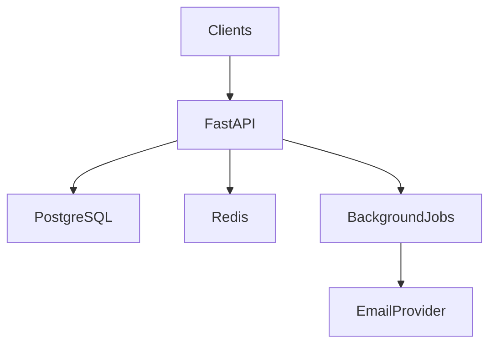
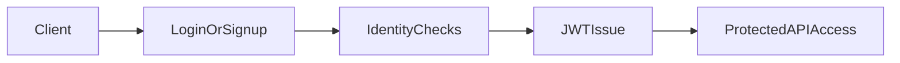
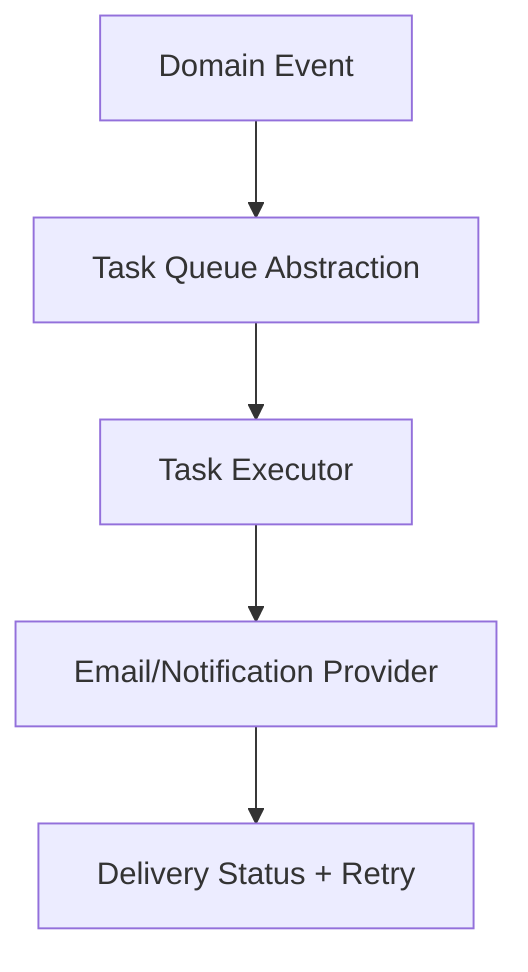

## Launchpad Project Specifications

🚀 Product launch and discovery platform for founders and makers.

---

## Launchpad Project Specifications

🚀 **Community-driven launch platform** with moderation, ranking, voting, discovery, and founder analytics.

---

## 📌 Problem (Core Idea)

Founders need a trusted platform to launch products and get community feedback, while members need high-signal discovery instead of noisy listings.

Without moderation, anti-abuse rules, and quality ranking, product discovery becomes low trust and low value.

➡️ **Launchpad provides structured submissions, moderated publishing, fair ranking, and real-time community interaction.**

---

## 🧑‍💻 Users

| Persona  | Needs |
| -------- | ----- |
| Visitor  | Browse launches and evaluate products |
| Member   | Vote, comment, follow topics and makers |
| Founder  | Submit products, schedule launch, track performance |
| Reviewer | Moderate submissions and reported content |
| Admin    | Govern platform integrity and policy actions |

---

## ✨ Core Features

### A) Accounts & Authentication

- Email/password signup/login
- Google sign-in
- Email verification
- Password reset and change
- JWT-based API authentication

### B) Product Submission & Moderation

- Draft submission workflow
- Structured submission metadata and assets
- Reviewer outcomes: approve, reject, request changes
- Founder notifications for moderation decisions

### C) Launch Scheduling & Visibility Rules

- Founder-selectable launch day for approved products
- Daily launch quota constraints per founder
- Embargo before launch day
- Restricted edit policy after launch

### D) Voting, Comments, and Reporting

- Single vote per member/product
- No self-voting
- Threaded comments and replies
- Report pipeline for moderation

### E) Discovery, Ranking, and Topic Views

- Dynamic trending ranking for daily launches
- Immutable historical day snapshots
- Topic leaderboard views (week/month/all-time)
- Search and filtering by relevance and recency

### F) Notifications & Background Jobs

- In-app and email notifications
- User-level email preference enforcement
- Durable async processing for retries and provider downtime

---

## 🗄️ Data Model (High-Level Direction)

Core entities will include:

- User and role assignments
- Product and submission lifecycle state
- Vote and comment threads
- Moderation actions and reports
- Notification preferences and delivery events
- Audit logs for staff operations

Detailed table/schema design is intentionally deferred to the dedicated data-modeling phase.

---

## 🧱 Tech Stack

| Category   | Choice |
| ---------- | ------ |
| Framework  | **FastAPI** |
| Language   | Python **3.10.12** |
| Database   | PostgreSQL |
| Caching    | Redis |
| Auth       | JWT (+ social sign-in integration) |
| ORM/Migrate| SQLAlchemy + Alembic |
| Validation | Pydantic |
| Background | Async task abstraction (worker-ready) |

---

## 🎨 UI / UX

Backend phase only:

- API-first architecture with `/api/v1`
- Optional SSR templates/static scaffolding for rapid iteration and parity with learning style
- Frontend application in separate `frontend/` directory to be implemented later

### Layout

- `backend/` for API + backend SSR scaffolding
- `frontend/` reserved for future dedicated frontend app

### Responsive

Frontend responsive strategy will be finalized during frontend architecture phase.

---

## 🔌 API Architecture

---

## 🔐 Auth Flow

---

## 🧠 Background Task Flow

---

## 🗂️ Development Workflow

- Modular monolith backend structure with feature boundaries
- Migration-first DB evolution
- Environment-separated configuration (`dev` and `prod`)
- Test split across unit and integration layers
- Quality gates: lint, type checks, tests

---

## 🧭 Roadmap

### **MVP**

- Auth and profile baseline
- Product submission + moderation
- Launch scheduling + voting + comments
- Core ranking/discovery

### **Phase 2**

- Personalized feed refinement
- Founder analytics and exports
- Notification resilience upgrades

### **Future Enhancements**

- Mobile clients
- Extended abuse detection
- Advanced recommendation and ranking intelligence

---

## 📌 Status

- Backend foundation scaffolded
- Configuration and standards baseline defined
- Ready for domain modeling and feature implementation
